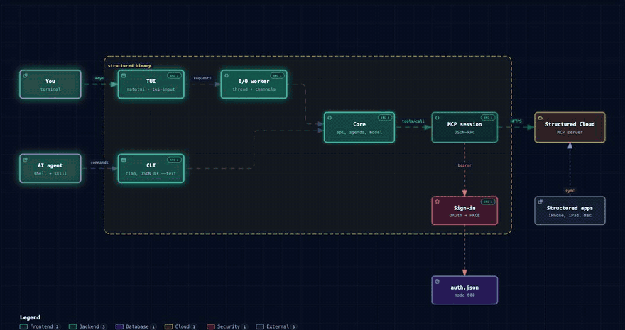

# System architecture

`structured` is one Rust binary. The CLI and the TUI share the same model, API layer, and MCP client, and both talk to Structured Cloud over its public MCP endpoint.

Open [architecture.html](assets/architecture.html) for the interactive version with the request trace. [architecture.archify.json](assets/architecture.archify.json) is its source.

## Components

| Component | Path | Role |
| --- | --- | --- |
| Entry | `src/main.rs` | Parses arguments with clap. Turns clap errors into the JSON error shape when output is piped. |
| CLI surface | `src/cli.rs` | Commands, flags, and help text. This is the contract agents read. |
| Dispatch | `src/lib.rs` | Loads config, sets the time zone, runs one command, or opens the TUI |
| Checklist commands | `src/subtask.rs` | `subtask list/add/done/undo/edit/delete` |
| Self-update | `src/update.rs`, `install.sh` | `structured update` fetches `install.sh` and runs it against its own directory |
| API layer | `src/api.rs` | One function per Structured tool. Builds arguments, enforces `--scope` on recurring days, merges three days for `now` |
| MCP client | `src/mcp.rs` | JSON-RPC over HTTP. Initializes once per session, sends `Mcp-Session-Id` when the server issues one, and short-circuits writes under `--dry-run` |
| Sign-in | `src/auth.rs` | OAuth with PKCE, dynamic client registration, a loopback redirect on `127.0.0.1:8734`, token refresh, and `auth.json` at mode 600 |
| Model | `src/model.rs` | `Task`, `Subtask`, and `TaskRef` (an id, or a recurring id plus a day) |
| Agenda | `src/agenda.rs` | Ordering, free gaps, overlaps, `late`, the now-line, and the 24-hour window. Used by both the TUI and `--text` |
| Clock | `src/clock.rs` | The zone in use, today, now, and date and time parsing |
| Config | `src/config.rs` | `config.toml`, the zone list, and `--tz` lookup |
| Output | `src/output.rs` | JSON envelopes and the text timeline |
| Errors | `src/error.rs` | Error codes, `retryable`, `next_steps`, and exit codes |
| TUI | `src/tui/` | Event loop, background worker, app state, and drawing |

## Request flow

A CLI command runs on one thread:

1. `main.rs` parses arguments. `lib.rs` loads `config.toml` and sets the zone from `--tz`, the first configured zone, or the system.
2. `api.rs` builds the tool arguments, including the zone name.
3. `mcp.rs` gets a bearer token from `auth.rs`, refreshing it when it expires within 30 seconds, and calls the tool.
4. `output.rs` prints one JSON object, or the text timeline.

Structured tools used: `get_today`, `get_tasks_for_day`, `list_tasks`, `get_inbox`, `get_account`, `create_task`, `update_task`, `complete_task`, and `delete_task`.

## Time zones

Structured Cloud files every task under one `day` that never changes with the zone. A task with a `timezone` gets its `start_time` counted from midnight of that day in the zone the request names, so the number can fall outside 0 to 24: `-11` is 13:00 the day before. A task with `timezone: null` floats and shows the same clock time everywhere, which is how recurring routines usually come back.

The client works in the zone on screen:

- `Task::settle` (`src/model.rs`) moves a time outside 0 to 24 onto the day it lands on, and keeps the filed day in `listed_day`. A recurring day's `ref` uses the filed day, because that is what the server looks it up by.
- `api::list` (`src/api.rs`) asks one day wider on each side, then keeps tasks whose settled day is in range. `today`, `day`, and `now` are one `list_tasks` call each.
- `api::anchor` turns a day or time typed on screen into update_task's terms. A one-off task is filed again under the day on screen with the new time and the screen's `timezone`, unless it floats. A recurring day keeps its filed day and gets the time in its own zone (`clock::rebase`) with no `timezone`, so a series is never re-zoned and a floating routine stays floating. A title or note edit sends no `timezone` at all.
- The CLI reads the task before a day or time edit so `anchor` has it. A one-off task no read can reach is edited without anchoring, as before.

The zone is process-wide state in `clock.rs`, so the TUI worker thread reads the same zone as the UI thread. Switching zones in the TUI clears the cache and reloads.

## TUI

`src/tui/mod.rs` runs the event loop: it polls keys every 80 ms, redraws on replies, key presses, and each new minute, and asks for a refresh every 20 seconds while idle.

`src/tui/worker.rs` owns the MCP session on a background thread. The UI sends `Load`, `Complete`, `Edit`, `Add`, `Delete`, and `Subtasks` requests and gets replies on a channel, so the screen never waits on the network.

`src/tui/app/` holds the state:

- A cache keyed by view: the 24h window, today, the inbox, or a date. Switching between cached views paints at once.
- Optimistic writes. A change paints first, and an undo entry waits for the server. A failed save puts the old value back.
- An epoch counter. A load that started before a write or a zone switch is dropped when it lands.
- Holds for recurring days being split from their series, so the old copy does not flash back before the server catches up.

`src/tui/view/` draws with ratatui: the header with the week strip and zone clock, the list, the details pane, the footer, and the help and confirm overlays.
